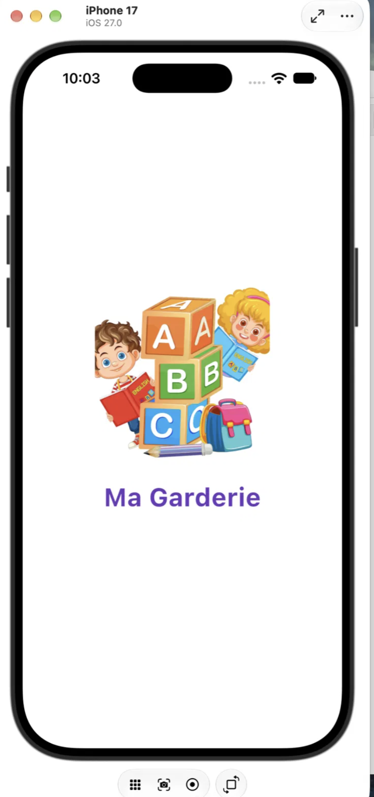
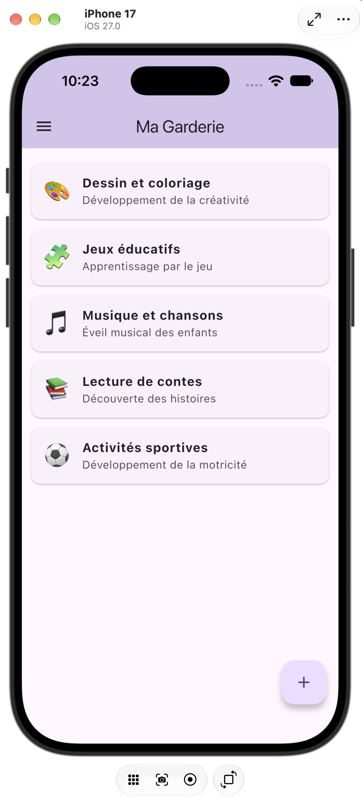
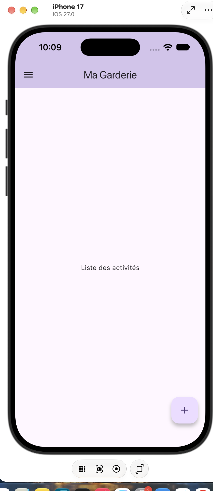
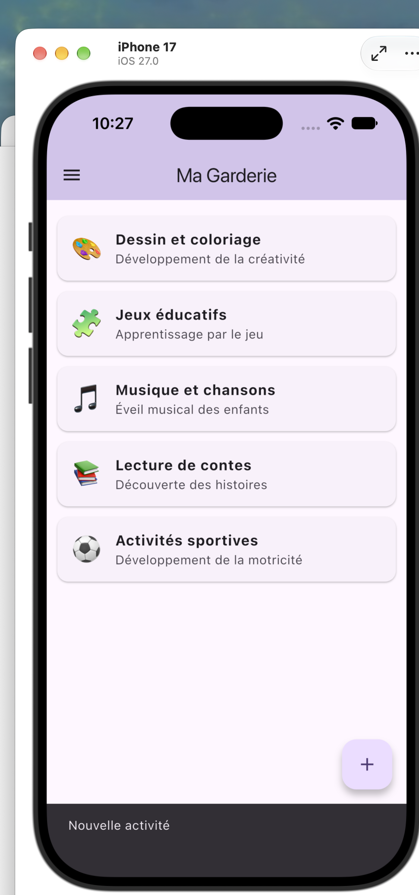

# Ma Garderie

Application mobile développée avec Flutter pour une garderie d'enfants. Elle présente les activités proposées aux enfants à travers une interface simple et colorée.

## Fonctionnalités

- Splash Screen avec image d'accueil et transition automatique après 3 secondes
- Page principale avec AppBar, Drawer (Accueil, Activités, À propos) et Floating Action Button
- Liste des activités affichée avec un `ListView` (données statiques déclarées dans le code)
- Interactions : Snackbar au clic sur le bouton +, sur une activité et dans le Drawer

## Technologies utilisées

- Flutter (Dart)
- Git et GitHub
- Visual Studio Code
- Simulateur iOS (Xcode)

## Installation et exécution

1. Cloner le dépôt :

```bash
   git clone https://github.com/Zayneb215/garderie-mobile.git
   cd garderie-mobile
```

2. Installer les dépendances :

```bash
   flutter pub get
```

3. Lancer un simulateur ou connecter un appareil, puis vérifier qu'il est détecté :

```bash
   flutter devices
```

4. Exécuter l'application :

```bash
   flutter run
```

## Captures d'écran

### Splash Screen


### Page principale avec la liste des activités


### Drawer ouvert


### Message affiché après une interaction


## Structure du projet

- `lib/main.dart` : point d'entrée de l'application
- `lib/splash_screen.dart` : écran de démarrage
- `lib/home_page.dart` : page principale, liste des activités et interactions
- `assets/images/` : images de l'application
- `screenshots/` : captures d'écran

## Auteur

Zayneb